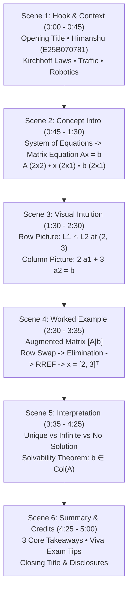

# Storyboard: Systems of Linear Equations ($Ax = b$)
**Linear Algebra and Calculus (M3) • Internal Assessment (Project Option 1: Animation Video)**

- **Student Name:** Himanshu
- **URN / Student ID:** E25B070781
- **Course:** Linear Algebra and Calculus (M3)
- **Target Video Duration:** Exactly 5 Minutes (300.00 Seconds)
- **Aspect Ratio & Resolution:** 16:9 Landscape, 1080p (1920×1080)
- **Audio Profile:** Pure Voiceover Mode (No background music, silent audio track for live narration)

---

## One-Sentence Learning Objective
> *"By the end of this video, the viewer will be able to formulate any linear system into the compact matrix equation $Ax = b$, geometrically contrast the Row Picture (intersecting hyperplanes) with the Column Picture (vector synthesis), systematically compute the exact solution using Gaussian Elimination on an augmented matrix, and classify the solution set using matrix rank and column space."*

---

## 6-Scene Detailed Storyboard Matrix

| Scene | Scene Title | Time Window | Duration | Mathematical Concept & Visual Architecture | Voice-Over / Narration Goal |
|---|---|---|---|---|---|
| **Scene 1** | **Hook / Context & Title Frame** | `0:00 - 0:45` | **45.0s** | **Opening Frame:** Formal course header, project option, student identity (Himanshu, E25B070781). **Real-World Motivation:** Three domain cards: Electrical Networks (Kirchhoff's Laws), Traffic Flow Equilibria, and Robotics Kinematics. Visualizing interconnected simultaneous constraints. | Introduce the central guiding question: *Why do simultaneous systems matter, and how do we solve complex interdependent variables at once?* Set the learning goals for the video. |
| **Scene 2** | **Concept Introduction ($Ax = b$)** | `0:45 - 1:30` | **45.0s** | **Algebraic Translation:** System of 2 equations ($2x_1 - x_2 = 1$, $x_1 + x_2 = 5$). Factoring into $A \in \mathbb{R}^{2 \times 2}$ (Coefficient Matrix), $\mathbf{x} \in \mathbb{R}^{2 \times 1}$ (Unknown State Vector), and $\mathbf{b} \in \mathbb{R}^{2 \times 1}$ (Target Vector). **Duality Cards:** Row dot product view vs Column combination view. | Demystify $Ax = b$. Explain that $A$ acts as a linear transformation operator that maps the input vector $\mathbf{x}$ to the constraint output $\mathbf{b}$. |
| **Scene 3** | **Visual Intuition: Row vs Column Picture** | `1:30 - 2:30` | **60.0s** | **Part A (Row Picture):** Animated 2D NumberPlane. Cyan Line $L_1: 2x_1 - x_2 = 1$ and Amber Line $L_2: x_1 + x_2 = 5$. Pulsating intersection dot at $(2, 3)$ with dashed axis projections. **Part B (Column Picture):** Column vectors $\mathbf{a}_1 = [2, 1]^T$ (Green) and $\mathbf{a}_2 = [-1, 1]^T$ (Purple). Scaled to $2\mathbf{a}_1 = [4, 2]^T$ and $3\mathbf{a}_2 = [-3, 3]^T$. Head-to-tail addition arriving precisely at $\mathbf{b} = [1, 5]^T$ (Gold). | Contrast the two fundamental geometric viewpoints of Gilbert Strang: Row Picture sees constraints intersecting; Column Picture sees vector synthesis in space. |
| **Scene 4** | **Worked Example: Gaussian Elimination** | `2:30 - 3:35` | **65.0s** | **Augmented Matrix $[A \mid b]$:** Display $\left[\begin{array}{cc\|c} 2 & -1 & 1 \\ 1 & 1 & 5 \end{array}\right]$. **Step 1 (Row Swap):** $R_1 \leftrightarrow R_2$ to select leading unit pivot. **Step 2 (Elimination):** $R_2 \leftarrow R_2 - 2R_1$, zeroing entry below pivot to reach Echelon Form $\left[\begin{array}{cc\|c} 1 & 1 & 5 \\ 0 & -3 & -9 \end{array}\right]$. **Step 3 (Normalization):** $R_2 \leftarrow -\frac{1}{3}R_2 \implies x_2 = 3$. **Step 4 (Back-Substitution / RREF):** $R_1 \leftarrow R_1 - R_2 \implies x_1 = 2$. Solution vector $\mathbf{x} = [2, 3]^T$ highlighted and verified. | Walk through every single arithmetic operation. Explain why Elementary Row Operations (EROs) preserve the solution set and how Gaussian Elimination guarantees finding the answer. |
| **Scene 5** | **Interpretation: Taxonomy & Column Space** | `3:35 - 4:25` | **50.0s** | **Three Regimes Comparison:** Side-by-side cards for Unique Solution ($\det(A) \neq 0$), Infinitely Many Solutions (coincident lines, free variables), and No Solution (parallel lines, inconsistency $[0 \dots 0 \mid c]$). **Column Space Theorem:** $Ax = b$ is consistent $\iff \mathbf{b} \in \text{Col}(A)$. Rouché–Capelli theorem: $\text{rank}(A) = \text{rank}([A \mid b])$. | Connect algebraic row reduction back to fundamental vector spaces. Explain why some systems fail to have solutions and what rank reveals about solvability. |
| **Scene 6** | **Summary, Viva Prep & Closing Credits** | `4:25 - 5:00` | **35.0s** | **3 Core Takeaways:** 1. Duality (Row vs Column), 2. Invariance (EROs preserve solutions), 3. Solvability ($\mathbf{b} \in \text{Col}(A)$). **Viva Tips:** Pivots, free variables, and homogeneous null space. **Official Closing Frame:** Himanshu, E25B070781, M3 Assessment, Manim Community engine, audio credits, AI disclosure. | Summarize key findings concisely. Leave the evaluator with a memorable conclusion and clear oral examination talking points. |

---

## Scene-by-Scene Visual Breakdown

---

## Pedagogical Strategy
1. **Geometric Grounding Before Abstract Manipulation:** We do NOT start with dry row reduction algorithms. We first ground the viewer in 2D geometry (Scene 3) so they understand *what* the equations mean before showing *how* to solve them algorithmically (Scene 4).
2. **Dual-Lens Perspective:** Introducing both the **Row Picture** (how computer scientists often view constraints) and the **Column Picture** (how data scientists and physicists view basis combinations) ensures a profound, intuitive grasp of linear algebra.
3. **Rigorous Verification:** Every algebraic transformation is verified by substitution back into the original equations.
